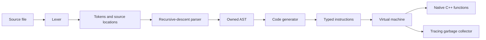

# Solstice Script

[](https://github.com/shifterkart18/SolsticeScript/actions/workflows/ci.yml)
[](LICENSE)

Solstice Script is a Lua-inspired scripting language, compiler, and bytecode
virtual machine. I originally created it in graduate school in 2012 after GDC
talks inspired me to learn how Lua worked by building a small language of my
own.

## The original project

My goal was not merely to parse Lua-like syntax. I wanted to understand the
complete path from source code to execution, so I wrote:

- a lexer
- a recursive-descent parser
- an abstract syntax tree
- a bytecode generator
- a stack-based virtual machine
- recursive function calls and local call frames
- strings, arrays, control flow, and native C++ functions

The milestone I was proudest of came from outside my own test programs. A
classmate in the Level Design track was learning Lua and gave me one of their
homework projects. Solstice Script successfully parsed and executed that
independently written assignment. It was an informal compatibility test that
showed the language had become more than a compiler exercise.

The original project remained intentionally smaller than Lua. Most notably, it
implemented arrays rather than Lua's general-purpose tables. It also did not
include closures, modules, coroutines, or the tooling expected from a
production language.

## The modernized edition

In 2026 I revisited the project and preserved its language and compiler-stage
design while replacing unsafe implementation mechanisms with modern C++20.
The current edition adds:

- ownership-safe AST nodes
- `std::variant` runtime values
- tracing mark-and-sweep garbage collection
- support for nested and cyclic arrays
- typed instructions rather than packed raw bytecode
- explicit function call frames
- source-located compile and runtime diagnostics
- a type-safe native extension API
- x64 Debug and Release builds
- automated tests, examples, and GitHub Actions CI

This repository represents the cleaned and modernized implementation, not an
unaltered snapshot of the 2012 source.

## Current architecture



1. `SLexicalAnalyzer` converts source text into tokens with file, line, and
   column information.
2. `SParser` builds an ownership-safe abstract syntax tree.
3. `SCodeGenerator` emits a typed instruction stream.
4. `SVirtualMachine` executes instructions using explicit call frames.
5. `GarbageCollector` traces strings, arrays, nested arrays, cyclic arrays, and
   values retained through the native boundary.

The public `SScript` API owns compiler and VM state through RAII. Native
functions use `std::function` and `std::span`, without untyped function
pointers.

## Requirements

- Visual Studio 2022 with Desktop development with C++
- MSVC v143 toolset
- Windows 10 or later SDK

The solution contains x64 Debug and Release configurations.

## Build

Open `SolsticeScriptCompiler.sln`, select `x64`, then build either Debug or
Release.

From a Visual Studio developer command prompt:

```powershell
msbuild SolsticeScriptCompiler.sln /t:Build /p:Configuration=Debug /p:Platform=x64
```

## Command line

```text
SolsticeScriptCompiler [options] <script.sun>
```

Options:

- `--compile-only`: compile without executing
- `--dump-tokens`: print lexer output
- `--dump-ast`: print the abstract syntax tree
- `--dump-bytecode`: print generated instructions
- `--help`: print command help

## Language

Implemented features include:

- numbers, strings, booleans, nil, and arrays
- nested and cyclic arrays
- global variables and scoped local variables
- recursive and forward function calls
- type-safe native function registration
- `if`, `elseif`, and `else`
- `while`, numeric `for`, `repeat/until`, and `do/end`
- arithmetic, comparisons, string concatenation, and short-circuit logic
- source-located compile and runtime diagnostics

See [LANGUAGE.md](LANGUAGE.md) for syntax and semantics.

## Examples

The [examples](examples/README.md) directory contains runnable programs for
recursion, sorting, matrices, scopes, control flow, cyclic arrays, garbage
collection, strings, and diagnostics.

Run the full successful sample suite:

```powershell
.\examples\Invoke-Examples.ps1 `
    -Executable .\x64\Debug\SolsticeScriptCompiler.exe
```

Additional design documentation:

- [Architecture](docs/ARCHITECTURE.md)
- [Design notes](docs/DESIGN.md)
- [Embedding guide](docs/EMBEDDING.md)

The [changelog](CHANGELOG.md) summarizes the modernization work.

## Native functions

```cpp
Solstice::SScript script;
script.RegisterFunction(
    "subtract",
    2,
    [](Solstice::SVirtualMachine&, std::span<const Solstice::SValue> arguments)
    {
        return Solstice::SValue::Number(
            arguments[0].AsNumber() - arguments[1].AsNumber());
    });
```

## Tests

The solution includes `SolsticeScriptTests`, which validates native function
ordering, repeated compilation, and recovery after compilation failures.

Script-level regression tests are run with:

```powershell
.\tests\Invoke-RegressionTests.ps1 `
    -Executable .\x64\Debug\SolsticeScriptCompiler.exe
```

## License

Solstice Script is available under the [MIT License](LICENSE).
